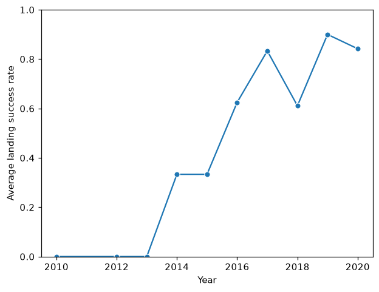

# SpaceX Falcon 9 Landing Prediction

IBM Applied Data Science Capstone project by **David Carro Salinas**: historical launch data collection, wrangling, exploratory analysis, SQL, Folium maps, a Plotly Dash app and four classification models.

Repository: https://github.com/DavidCarSal/SpaceX-Falcon9-Landing-Prediction

## Final presentation

**Ready-to-upload report:** [Data Science Capstone Project Report.pdf](presentation/Data%20Science%20Capstone%20Project%20Report.pdf), 40 slides, in English.

[Editable PowerPoint](presentation/Data%20Science%20Capstone%20Project%20Report.pptx) contains the same report. The PDF was exported from Microsoft PowerPoint, rendered and visually reviewed page by page. It includes the real repository link, executed EDA and SQL results, actual Folium and Dash browser captures, sourced proximity measurements, four model scores, the selected confusion matrix, conclusions and limitations.

Earlier drafts and the preliminary evidence supplement are kept only in [presentation/archive/](presentation/archive/). **Use the 40-slide final report for the submission.**

## Verified status

Reviewed on **13 November 2026**, using Python 3.12. Six notebooks completed execution with saved outputs. The API notebook stopped because a SpaceX rockets endpoint returned **HTTP 522**. The subsequent analyses use separately downloaded IBM course snapshots and do not depend on a successful live API collection run.

| Notebook | Execution evidence |
| --- | --- |
| [01 API collection](notebooks/01_data_collection_api.ipynb) | Partial execution; external HTTP 522 recorded |
| [02 Web scraping](notebooks/02_web_scraping.ipynb) | Completed; 121 parsed records from the fixed Wikipedia revision |
| [03 Data wrangling](notebooks/03_data_wrangling.ipynb) | Completed; 90 records, 60 successful and 30 unsuccessful labels |
| [04 EDA and visualization](notebooks/04_eda_visualization.ipynb) | Completed; seven saved plots and encoded features |
| [05 SQL analysis](notebooks/05_eda_sql.ipynb) | Completed; ten queries and result tables |
| [06 Folium maps](notebooks/06_folium_maps.ipynb) | Completed; HTML maps exported; sourced OSM proximity measurements and browser captures included |
| [07 Machine learning](notebooks/07_machine_learning.ipynb) | Completed; four tuned models and saved confusion matrices |

The execution method was IPython in-process with a fresh namespace for each notebook. An attempted Jupyter kernel execution did not complete in this environment. See [validation details](reports/validation.md), [recorded package versions](reports/environment.json) and each notebook's execution record in `reports/`.

## Results

The best mean training cross-validation score selected a decision tree. It classified **15 of 18 test cases correctly**. The holdout was stratified, with 72 training and 18 test records and random seed 2. Scaling is fitted within each cross-validation training fold using a scikit-learn `Pipeline`.

| Model | Mean training CV accuracy | Test accuracy |
| --- | ---: | ---: |
| Decision tree | 0.8893 | 0.8333 |
| SVM | 0.8625 | 0.8333 |
| KNN | 0.8482 | 0.7222 |
| Logistic regression | 0.8339 | 0.7778 |

[Full scores and parameters](reports/model_scores.csv)



These are educational retrospective results. A random historical holdout does not establish future operational performance. Booster identity, reuse counts and flight counts require a point-in-time availability audit. The course feature encoding uses the full historical dataset; temporal validation and fold-specific feature engineering remain future work. Small sample sizes make individual test scores unstable.

## Project layout

```text
app.py             Plotly Dash dashboard
notebooks/         Seven reviewed notebooks with execution outputs
data/source/       Untouched downloaded IBM snapshots
data/              Working datasets, generated features and provenance
images/            Actual notebook plots
reports/           Scores, ten SQL results, HTML map and execution records
presentation/      Evidence supplement and clearly labeled original drafts
scripts/           Data download and project validation
requirements.txt   Versions used for execution, plus JupyterLab
NOTICE.md          Source attribution and reuse notes
```

## Run locally

Use Python 3.12 and a virtual environment. Windows PowerShell:

```powershell
python -m venv .venv
.\.venv\Scripts\Activate.ps1
python -m pip install -r requirements.txt
python -m jupyter lab
```

Open the notebooks in order. Set their working directory to `notebooks/` (the usual Jupyter behavior when opening them there). Relative paths refer to `../data` and `../reports`. Re-running API collection may overwrite `data/dataset_part_1.csv` if the remote service is available. To restore the course inputs, run `python scripts/download_data.py` from the repository root. That script preserves `data/source/` and bootstraps missing part 2 and 3 files. Execute notebooks 03 and 04 to regenerate those two working datasets.

Notebooks 03 onward can use the included snapshots without internet. Notebook 01 needs the SpaceX endpoints and course JSON endpoint. Notebook 02 needs Wikipedia. Rendering Folium basemaps and loading its browser libraries requires internet even though the notebook can generate the HTML locally.

### Dashboard

From the repository root:

```powershell
python app.py
```

Open the local URL printed by Dash. The launch-site dropdown and payload range update both charts. Automated checks verified filters, empty subsets, layout endpoints and a real Dash callback HTTP request. Microsoft Edge browser checks also exercised the site dropdown and slider. Actual captures for all sites, KSC LC-39A and a 2,000-5,000 kg payload range are included in `images/`.

### Validation

```powershell
python scripts/validate_project.py
```

This checks source hashes, all seven notebook schemas, six saved successful execution records, class labels, feature data, model score bounds and dashboard responses. It does not re-execute notebooks. It also checks the final presentation file structure, 40 PDF pages, author, repository hyperlink, absence of result placeholders and OSM source hash. The API's external failure is documented rather than counted as a successful execution.

## Data and provenance

Original downloads are listed in [data/sources.json](data/sources.json), with URLs, retrieval times and SHA-256 hashes. [Working-file hashes](data/working_files.json) record the files included in this version. Data wrangling generates part 2; EDA generates part 3. SQL, Folium and Dash use their own distinct course datasets. Their populations and success counts should not be mixed.

The Wikipedia parser returned 121 records. This is a parser execution result, not proof that every launch or merged table cell was captured correctly. The scraped data is not used to train the classifiers.

## Interpretation limits

The live API enrichment attempt returned HTTP 522, so notebook 01 is retained as a partial run. The executed analyses use independently downloaded IBM course snapshots. This limitation is stated in the final report; no live API output is invented.

The geographic distances are approximate straight-line distances to returned OSM features at retrieval time. The mapped rail spur is within 0.01 km of the coarse course coordinate, which does not imply survey accuracy. The selected major-road query includes a private secondary road; town distance is to a mapped centre. They are not travel distances or historical infrastructure measurements.

Use a temporal evaluation and audit every feature's pre-launch availability before attempting operational prediction. The final presentation covers the requested report sections; the assessment result remains the evaluator's decision.

## Geographic reproducibility

The Overpass query, raw response and retrieval/hash metadata are in `data/osm_proximity_query.txt`, `data/osm_proximity.json` and `data/osm_provenance.json`. Measurements and object IDs are in [reports/proximity_measurements.json](reports/proximity_measurements.json). To recompute them from the preserved geometry:

```powershell
python scripts/proximity_analysis.py
```

## Attribution

Based on the supplied IBM / Skills Network Applied Data Science Capstone labs and their historical datasets. Original notebook acknowledgments and copyright notices are retained. This is an educational portfolio project, with no affiliation with SpaceX. See [NOTICE.md](NOTICE.md).
